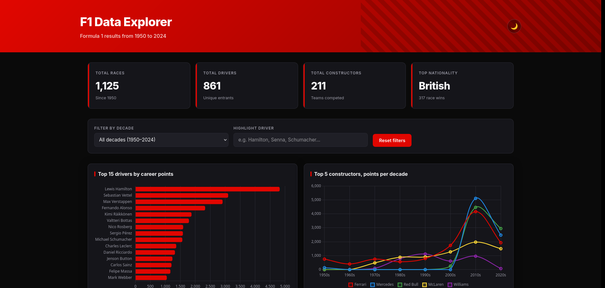

# F1 Data Explorer


[](LICENSE)

Dashboard of Formula 1 results from 1950 to 2024, in a single HTML file with Chart.js and PapaParse.
The [live version](https://marin-orejas.github.io/f1-data-explorer/) runs on GitHub Pages.



## Highlights

- The browser joins 26,759 race results from 75 seasons with races, drivers and constructors.
- A single decade filter updates 4 summary cards, 5 Chart.js charts and a results table.
- Typing a driver's name highlights that driver in the top 15 chart and in the results table.
- The app is a single HTML file with the data inside, so it needs no backend and no build step.

## Data

The data comes from the Ergast Motor Racing database, through the [Formula 1 World Championship dataset on Kaggle](https://www.kaggle.com/datasets/rohanrao/formula-1-world-championship-1950-2020).
`index.html` stores the 4 tables as CSV text, so the page makes no data requests.

| Table | Rows | Used for |
|---|---|---|
| `races` | 1,125 | Year and Grand Prix name |
| `results` | 26,759 | Grid position, finishing position and points per driver per race |
| `drivers` | 861 | Name and nationality |
| `constructors` | 212 | Team name |

## Loading

The page prepares the data once, when it opens.

1. PapaParse reads the 4 CSV tables from `index.html`.
2. The page builds a lookup by ID for races, drivers and constructors.
3. The page joins each result to its race, driver and constructor, and adds its decade.
4. The cards, charts and table read from this joined list.

## Dashboard

The decade filter applies to the cards, the charts and the table.
The findings always use the whole dataset.

| Part | Content |
|---|---|
| Summary cards | Race, driver and constructor counts, top nationality by race wins |
| Top 15 drivers | Drivers with the most points |
| Top 5 constructors | Points per decade for the 5 constructors with the most points |
| Nationalities | The 10 nationalities with the most drivers |
| Grid and finish | Starting against finishing position, for 500 random race entries |
| Grands Prix | The 10 Grands Prix held most often |
| Results table | Top 100 race results by points, sortable by any column |
| Findings | 4 facts, such as how often the driver starting on pole wins |

## Tech stack

| Layer | Tools |
|---|---|
| Data | CSV, PapaParse |
| Frontend | JavaScript, HTML, CSS |
| Charts | Chart.js |
| Hosting | GitHub Pages |

## Run locally

Requires a browser with an internet connection, because Chart.js, PapaParse and the font load from a CDN.

1. Clone the repository:
   ```bash
   git clone https://github.com/marin-orejas/f1-data-explorer.git
   ```
2. Open `index.html` in a browser. The dashboard appears when the 4 tables finish loading.

## License

MIT, see [LICENSE](LICENSE).
